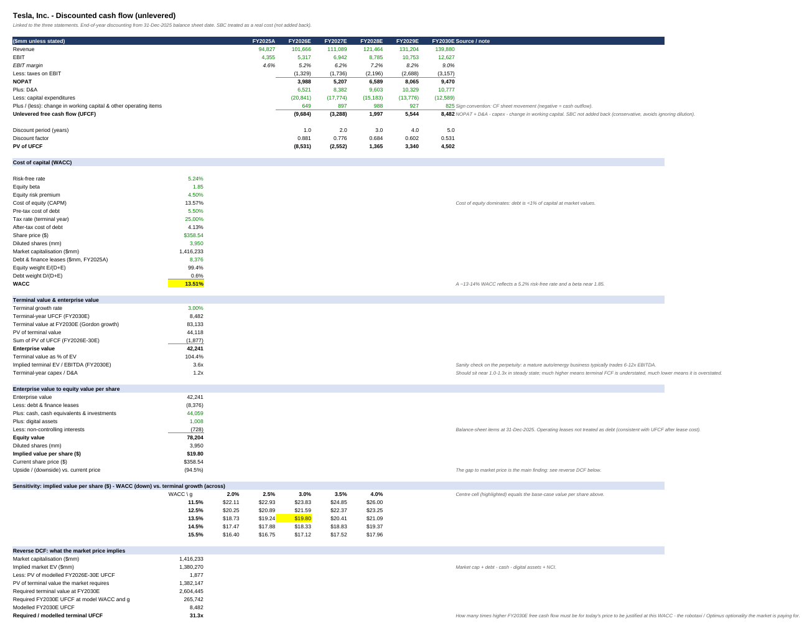
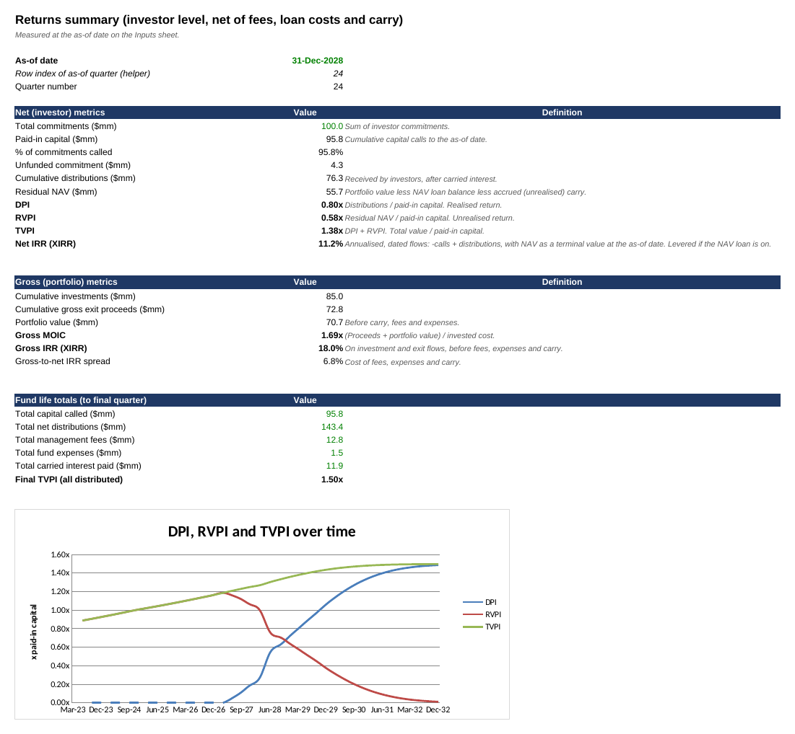

# Financial Modelling Portfolio

Two Excel models built from scratch, fully linked, with built-in integrity checks. Excel files don't preview on GitHub, so each model ships with a **PDF export** and **screenshots** alongside the `.xlsx`.

| Model | What it answers | Headline output | Open |
|---|---|---|---|
| **[Tesla: 3-statement model + DCF](tesla-dcf-model/)** | What is Tesla worth on a fundamentals-only DCF, and what would the market price need to believe? | Base $19.80/share vs $358.54 market; reverse DCF needs FY2030E FCF ~31x the base case | [PDF](tesla-dcf-model/pdf/Tesla_3-Statement_DCF_Model.pdf) · [xlsx](tesla-dcf-model/model/Tesla_3-Statement_DCF_Model.xlsx) |
| **[Fund model with NAV loan](fund-model-nav-loan/)** | How do fees, carry and a NAV facility change LP returns (DPI / RVPI / TVPI / IRR)? | Net IRR 11.2% vs gross 18.0%; NAV loan pulls DPI forward but lowers TVPI | [PDF](fund-model-nav-loan/pdf/Fund_Model_with_NAV_Loan.pdf) · [xlsx](fund-model-nav-loan/model/Fund_Model_with_NAV_Loan.xlsx) |

**Conventions in both workbooks:** blue = hard-coded input, black = formula, green = cross-sheet link, yellow = key assumption. Every model has a Checks sheet that must read `ALL CHECKS PASS`.

*Educational portfolio work built from public filings and illustrative assumptions. Not investment advice.*
