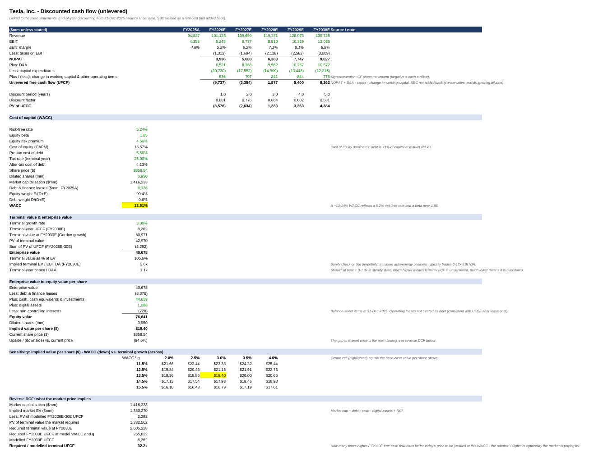

# Tesla, Inc.: Integrated 3-Statement Model and DCF

**What it does.** Income statement, balance sheet and cash flow are fully linked (FY2023A-25A historicals, FY2026E-30E forecast, US$mm), and the DCF reads its cash flows straight from them. One switch (`Assumptions!B3`) runs Bear / Base / Bull. Supporting schedules build automotive revenue from deliveries x revenue per delivery, energy revenue from GWh deployed x revenue per GWh, roll deferred revenue forward, and run a debt schedule by tranche. Includes a WACC x terminal-growth sensitivity table and a reverse DCF.

**Key assumption choices**
- **Bottom-up revenue:** auto = deliveries x core revenue per delivery + regulatory credits (running down from $2.0bn as US programmes are curtailed); energy = GWh deployed x revenue per GWh (falling ~6% in FY2026E on pricing pressure). The old top-down growth-rate method is kept as a cross-check, within 2% (auto) and 9% (energy) of the build by FY2030E.
- **Cost of capital:** risk-free 5.24% (US 10Y, 29-Sep-2026), beta 1.85, ERP 4.5% -> cost of equity 13.6%, **WACC 13.5%** (debt is <1% of capital). Terminal growth 3.0%.
- **Capex:** FY2026E calibrated to management's ">$20bn" guidance, fading to 9% of revenue by FY2030E.
- **SBC is treated as a real cost** (not added back). Debt interest comes from the tranche schedule, and deferred revenue from the roll-forward.

**Key outputs**

| Scenario | Value / share | vs $358.54 |
|---|---|---|
| Bear | $12.90 | -96% |
| **Base** | **$19.40** | **-94.6%** |
| Bull | $34.49 | -90% |

Enterprise value (Base) $40.7bn. The reverse DCF shows the market price needs FY2030E free cash flow **~32x** the base case, i.e. the price is paying for robotaxi / Optimus optionality the model does not explicitly forecast.

**Integrity.** The statements tie to reported Tesla figures (revenue, gross profit, EBIT, net income, CFO, FCF, total assets and liabilities: all differences zero), the balance sheet balances every year, and the schedules tie back: debt and deferred revenue closing balances equal the balance sheet, and the segment build sums to total revenue. Status: `ALL CHECKS PASS`.

**Limitations (stated in the model).** 5-year explicit period is short for a business still investing heavily (implied terminal EV/EBITDA only ~3.6x, so treat the value as a conservative floor). The debt tranche split, rates and the deferred-revenue recognition rate are estimates built from Q1-2026 10-Q disclosures and should be verified against the 10-K notes. No explicit robotaxi/Optimus segment. Balance-sheet date (Dec-2025) vs price date (Sep-2026) not rolled forward; share count differs by source.

**More screenshots:** [Assumptions](screenshots/02-assumptions.png) · [Schedules: revenue and deferred revenue](screenshots/07-schedules-revenue-deferred-revenue.png) · [Schedules: debt](screenshots/08-schedules-debt.png) · [Income statement](screenshots/03-income-statement.png) · [Balance sheet](screenshots/04-balance-sheet.png) · [Cash flow](screenshots/05-cash-flow.png) · [Checks](screenshots/06-integrity-checks.png)

**Files:** [PDF export](pdf/Tesla_3-Statement_DCF_Model.pdf) · [Excel model](model/Tesla_3-Statement_DCF_Model.xlsx). Sources are logged on the `Sources` sheet (Tesla Q4/FY2025 Update, FY2025 10-K, market data).
