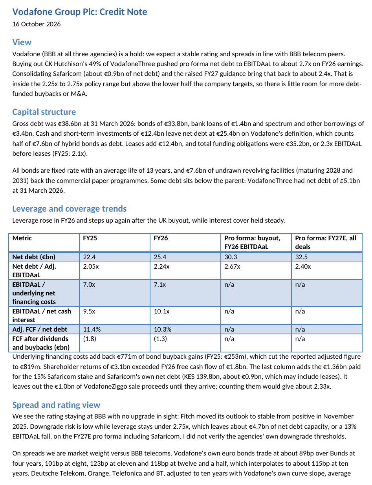

# Vodafone Group Plc: Credit Note and Euro DCM Pricing Model

**What it is.** A two-page credit note (16 October 2026) with a companion Excel workbook. The note gives a **hold** view on Vodafone (BBB at all three agencies). The workbook calculates the credit metrics behind it and prices an illustrative new euro 10-year senior bond off Vodafone's own bond curve.

**The view.** Stable BBB rating, spreads in line with BBB telecom peers. After the VodafoneThree buyout, pro forma net debt / EBITDAaL is ~2.7x on FY26 earnings. Consolidating Safaricom and the raised FY27 guidance bring that back to ~2.4x: inside the 2.25x-2.75x policy range but above the lower half the company targets, so there is little room for more debt-funded buybacks or M&A.

**Key outputs (from the workbook)**

| Metric | FY25 | FY26 | Pro forma: buyout | Pro forma: FY27E, all deals |
|---|---|---|---|---|
| Net debt (EUR bn) | 22.4 | 25.4 | 30.3 | 32.5 |
| Net debt / Adj. EBITDAaL | 2.05x | 2.24x | 2.67x | 2.40x |
| EBITDAaL / underlying net financing costs | 7.0x | 7.1x | n/a | n/a |

- **Headroom:** ~EUR 4.7bn of net debt capacity to the 2.75x top of the range, equivalent to a 13% fall in EBITDAaL.
- **Illustrative new 10-year:** own-curve spread ~115bp over Bunds, re-offer yield 4.53%, 4.5% coupon, issue price 99.76. Cross-checks: peer average 119bp (+4bp), three-bond regression 111bp (-4bp).
- **Refinancing drag:** replacing the 2026 and 2027 maturities at that coupon adds ~EUR 38m of annual interest.

**Key method choices**
- **Price off the issuer's own curve:** peers and a regression are cross-checks, not inputs.
- **Calibrated to a real print:** the workbook reprices Vodafone's February 2026 15-year bond from its price and ties to the reported yield within 0.5bp, then reconciles the move to today's curve (Bund move plus roll-down, residual -4bp).
- **Net debt on Vodafone's definition** (half of hybrids counted as debt). Pro forma figures include Safaricom net debt and exclude the EUR 1.0bn VodafoneZiggo proceeds until received (toggle on `Inputs`).
- **Sensitivity grid:** pro forma leverage under EBITDAaL cases and extra net debt, plus a price grid for spread and Bund moves.

**Limitations (stated in the files).** Quoted in Bund spreads rather than the market's usual mid-swaps, because no public live swap data was available. Two bond quotes date from 30 September. Agencies' own downgrade thresholds were not verified. One source for the Fitch outlook is secondary. Illustrative pricing only, not a trading view.

**More screenshots:** [Credit metrics](screenshots/02-credit-metrics.png) · [Bond curve and peers](screenshots/03-comps-bond-curve.png) · [DCM pricing](screenshots/04-dcm-pricing.png) · [Anchor deal calibration](screenshots/05-anchor-deal-calibration.png) · [Inputs](screenshots/06-inputs.png) · [IG vs HY terms](screenshots/07-terms-covenants.png)

**Files:** [Credit note (PDF)](pdf/Vodafone_Credit_Note.pdf) · [Credit note (Word)](note/Vodafone_Credit_Note.docx) · [Model (PDF export)](pdf/Vodafone_Credit_DCM_Model.pdf) · [Model (Excel)](model/Vodafone_Credit_DCM_Model.xlsx)

*Educational work based on public information. Not investment advice.*
