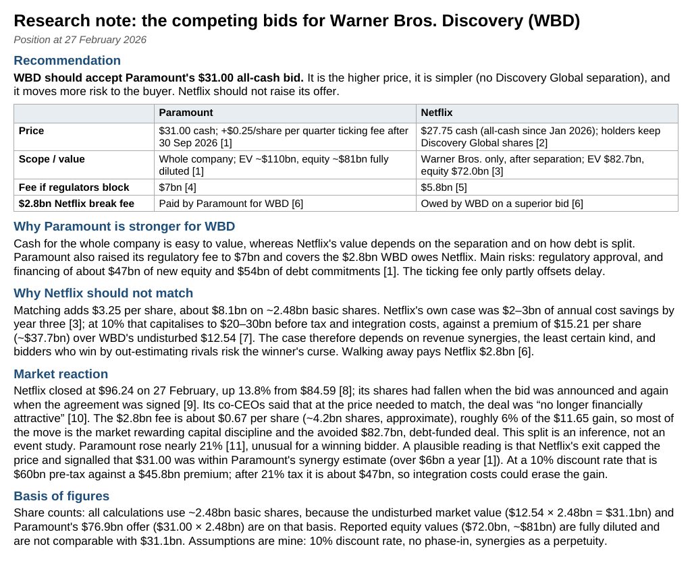

# Research Note: The Competing Bids for Warner Bros. Discovery (WBD)

**What it is.** A one-page investment-banking-style research note (position at 27 February 2026) advising WBD's board on Paramount's $31.00 all-cash bid versus Netflix's $27.75 offer, and whether Netflix should raise its bid.

**Recommendation.** WBD should accept Paramount's $31.00 all-cash bid. It is the higher price, it is simpler (no Discovery Global separation), and it moves more risk to the buyer. Netflix should not raise its offer.

**Key analytical choices**
- **Common share basis:** all per-share maths uses ~2.48bn basic shares, so the undisturbed market value, Paramount's $76.9bn offer and the premiums are comparable. Reported fully diluted equity values are kept separate.
- **Why Netflix should not match:** matching adds $3.25 per share (~$8.1bn). Netflix's cost-savings case of $2-3bn a year capitalises to $20-30bn at a 10% discount rate, against a ~$37.7bn premium over the undisturbed $12.54. The case therefore rests on revenue synergies and risks the winner's curse.
- **Market reaction:** Netflix rose 13.8% on the day. The $2.8bn break fee explains only ~6% of that gain, which the note reads as the market rewarding capital discipline. It labels this an inference, not an event study.
- **Paramount's synergies:** over $6bn a year is worth ~$60bn pre-tax at 10% (about $47bn after 21% tax) against a $45.8bn premium, so integration costs could erase the gain.

**Assumptions.** 10% discount rate, no phase-in, synergies as a perpetuity. All sources and access dates are listed on page 2.

**Files:** [PDF](pdf/WBD_Research_Note.pdf) · [Word document](note/WBD_Research_Note.docx)

*Educational research exercise based on public information. Not investment advice.*
